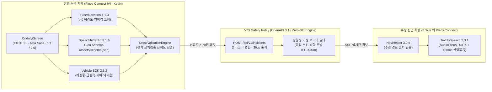

# ON:DO (온도)

> **앱 한 줄 소개:** 고속도로 사고 목격 순간 **원터치로 `t=0` 정밀 이정(km 기점)을 고정·음성 제보**하고, 차량 센서 교차 검증을 거쳐 **후방 2~3km 접근 차량에 실시간 차선 회피·서행 경고를 중계**해 치명적인 2차 사고를 막는 **Pleos Connect 차량 특화 안전 연대 서비스**

- **슬로건:** *도로(道) 위에 켜지는(ON) 사람의 따뜻한 체온 — "누군가의 삶을 지켜온 온도가 과거에서 현재로, 미래까지 이어질 수 있도록"*
- **출품 패키지명 / 버전:** `io.ondo.pleos` · `v1.1.0 (versionCode 2)`
- **APK 산출물 위치:**
  - Release APK (권장 설치본): [`apk/ondo-pleos-release.apk`](./apk/ondo-pleos-release.apk)
  - Debug APK (개발 검증본): [`apk/ondo-pleos-debug.apk`](./apk/ondo-pleos-debug.apk)
- **시연 영상 위치 (`1920×1080`, `16:9`, `30fps`):**
  - Pleos Connect v1.1.0 앱 실행 본편 (45초): [`demo/ondo-pleos-ivi-demo.mp4`](./demo/ondo-pleos-ivi-demo.mp4)
  - 브랜드 서사 + 앱 실행 통합 필름 (1분 25초 · 85초): [`demo/ondo-full-90s-film.mp4`](./demo/ondo-full-90s-film.mp4)

---

## 1. 기획 의도 및 차량 특화 핵심 기능

시속 100km(초당 약 28m)로 달리는 고속도로에서 사고를 목격했을 때 스마트폰을 꺼내 조작하는 행위는 그 자체로 위험하며, 음성 통화로 신고하는 10\~15초 사이 차량은 이미 사고 지점에서 **300\~400m 이상 벗어난 뒤**라 정확한 위치를 설명하기 어렵습니다. 무엇보다 고속도로 **2차 사고 치사율은 일반 사고의 약 6.5~6.8배(54.3%, 한국도로공사 고속도로 교통사고 통계)** 에 달합니다.

**`ON:DO (온도)`** 는 모바일 앱으로는 절대 구현할 수 없는 **Pleos Connect IVI 대화면 + 5종 차량 네이티브 SDK + 초저지연 V2X 중계 아키텍처**를 결합해 이 문제를 정면으로 해결합니다.

1. **`t=0` 정밀 이정 스냅샷 고정 & 3초 핸즈프리 음성 제보 (`FusedLocation` + `SpeechToText` + `Gleo AI`)**
   - 화면 원터치 버튼(또는 Gleo AI 음성 호출) 즉시(`t=0`) 사고 목격 시점의 위경도·주행 방위각을 스냅샷 고정하여 **노선·진행 방향·100m 단위 이정(`경부선 하행 342.5km`)** 을 0.8초 내에 영구 고정합니다. 차량이 계속 주행해 지나쳐도 신고 좌표 오차가 발생하지 않습니다.
   - 운전자는 전방을 주시한 채 *"2차로 화물차 전복, 파편 주의"* 한마디만 말하면 차로·사고 유형 슬롯이 자동 추출됩니다.
2. **차량 물리 센서 기반 실시간 허위 신고 필터링 (`Vehicle SDK` Cross-Validation)**
   - 제보 전후의 **비상경고등 점등(`Hazard`), 종방향 급감속도(`m/s²`), 주행 속도 변화, 결빙 위험 외기온도(`≤ 3.0°C`)** 및 인접 차량 동시 제보를 가중 합산해 신뢰도(`0~99%`)를 검증하고 허위·장난 신고를 원천 차단합니다.
3. **방향성 고속도로 코리더(`후방 0.1~3.0km`) 실시간 '온도 릴레이' (`NaviHelper` + `TextToSpeech`)**
   - 한국도로공사(ex) 관제 포맷 전송과 동시에, 동일 노선·동일 방향 뒤편 2~3km에서 접근 중인 차량의 `NaviHelper` 경로와 대조해 **차량 오디오 포커스 덕킹(`DUCK`) + `180ms` 선행 묵음(Pre-roll Silence) TTS 음성 경보**와 우측 차선 회피 가이드를 즉시 송출합니다.
4. **주행 안전 규제(`CarUxRestrictions`) 준수 및 기어 `P` 주차장 뷰 · `36.5°C` 리포트**
   - 주행 중(`Gear D`)에는 모든 문구를 **3줄 이내 대형 `Asta Sans` 타이포그래피**로 제한(`주행안전 DO`)하며, 목적지 도착 후 기어 `P` 정차 시 내비게이션 주차장 정차 뷰 전환과 함께 보호한 후방 차량 수(`38대`) 및 안전 마일리지·블루멤버스 포인트 리포트(`주차 모드`)를 브리핑합니다.

---

## 2. Pleos Connect 공식 디자인 시스템 & 5대 SDK 엔지니어링 구현

### 2.1 시스템 아키텍처 및 실시간 데이터 파이프라인



### 2.2 Pleos Connect 공식 SDK 및 플랫폼 가이드 적용 내역

| 구분 | 적용 모듈 / 공식 버전 | 구현 파일 및 핵심 엔지니어링 처리 |
| :--- | :--- | :--- |
| **Vehicle State** | `ai.pleos.playground:Vehicle:2.3.2` | [`PleosConnectSdkBridge.kt`](./app/src/main/java/io/ondo/pleos/sdk/PleosConnectSdkBridge.kt) — 비상경고등·종방향 감속도·기어(`P/R/N/D`)·외기온도 실시간 구독 및 에뮬레이터 안전 폴백 |
| **Fused Location** | `ai.pleos.playground:FusedLocation:1.1.3` | [`HighwayMilepostResolver.kt`](./app/src/main/java/io/ondo/pleos/domain/HighwayMilepostResolver.kt) — 버튼 터치 즉시(`t=0`) 위경도·방위각 스냅샷 고정 및 고속도로 상/하행 km 기점 산출 |
| **Navigation** | `ai.pleos.playground:NaviHelper:3.0.5` | [`PleosConnectSdkBridge.kt`](./app/src/main/java/io/ondo/pleos/sdk/PleosConnectSdkBridge.kt) — 내 주행 노선·방향과 전방 사고 이정 코리더 일치 여부 판별 |
| **Voice STT / TTS** | `SpeechToText:3.3.1` / `TextToSpeech:3.3.1` | [`PleosConnectSdkBridge.kt`](./app/src/main/java/io/ondo/pleos/sdk/PleosConnectSdkBridge.kt) — `AUDIOFOCUS_GAIN_TRANSIENT_MAY_DUCK` 획득 및 첫 음절 잘림 방지용 **`180ms` 선행 묵음(Pre-roll Silence)** 적용 |
| **Gleo AI Schema** | `assets/schema.json` + Manifest Intent | [`schema.json`](./app/src/main/assets/schema.json), [`AndroidManifest.xml`](./app/src/main/AndroidManifest.xml) — `REPORT_HIGHWAY_INCIDENT`, `CHECK_AHEAD_HAZARDS` 영문 스키마 규격 준수 |
| **주행 안전 규제** | `CarUxRestrictions` + `distractionOptimized` | [`DrivingRestrictionMonitor.kt`](./app/src/main/java/io/ondo/pleos/sdk/DrivingRestrictionMonitor.kt) — 기어 `D` 주행안전 DO 배지 및 3줄 이내 글랜서블 카드 전환 |
| **전원 Suspend 대응** | Activity `onStop()` Lifecycle | [`MainActivity.kt`](./app/src/main/java/io/ondo/pleos/MainActivity.kt) — 시동 OFF / IVI 절전 진입 시 마이크·센서·오디오 포커스 즉시 해제(`onSuspendEntering()`) |
| **공식 디자인 토큰** | Pleos Figma 215 (`Asta Sans` · `#1D1E21`) | [`OndoIviScreen.kt`](./app/src/main/java/io/ondo/pleos/ui/OndoIviScreen.kt) — 좌측 OS 속도계와 중복 없는 순수 앱 윈도우, `1:1 Portrait` / `2:0 Landscape` 반응형 레이아웃, `144dp/90dp` 세이프존 어댑티브 아이콘 |

### 2.3 센서 교차 검증(`CrossValidationEngine`) 신뢰도 산출 모델

단일 음성 발화만으로 후방 차량에 잘못된 경보가 전파되지 않도록 차량 물리 신호를 결합해 점수를 산출합니다 (`≥ 70점` 시 자동 관제·V2X 전파):

| 검증 시그널 항목 | 조건 | 가중 점수 | 비고 |
| :--- | :--- | :---: | :--- |
| 기본 제보 접수 (`t=0` 스냅샷 + STT 슬롯 유효) | 노선·방향·차로 유효 | `+45점` | 기본 베이스라인 |
| 비상경고등 점등 (`Vehicle SDK`) | `isHazardLampOn == true` | `+20점` | 실제 위험 목격 시 운전자 즉각 반응 |
| 급감속 물리 센서 (`Vehicle SDK`) | `deceleration ≤ -2.5 m/s²` | `+20점` | 회피 제동 물리 데이터 일치 |
| 동절기 살얼음 주의 외기온 (`Vehicle SDK`) | `ambientTemp ≤ 3.0°C` | `+5점` | 블랙아이스 연쇄 추돌 가중치 |
| 인접 구간 다중 차량 동시 제보 (V2X 클러스터) | 반경 `±0.4km` 내 `+1대` 이상 | `+15점` | 교차 검증 확정 (최대 `99점` 캡) |

---

## 3. 저장소 디렉터리 구조 (공개 제출 영역 vs 비공개 서브모듈 분리)

```text
├── app/                                  # [공개] Android Kotlin Pleos Connect IVI 클라이언트 전체 소스
│   └── src/
│       ├── main/assets/schema.json       # Gleo Interface 공식 함수 호출 스키마
│       ├── main/java/io/ondo/pleos/      # Domain(이정·교차검증) · 5-SDK 브리지 · Jetpack Compose IVI UI
│       └── test/java/io/ondo/pleos/      # 핵심 도메인·스키마·선행묵음 JUnit 단위 테스트 (6종)
├── apk/                                  # [공개] 즉시 설치 가능한 빌드 산출물 APK
│   ├── ondo-pleos-release.apk            # 서명 완료된 Release APK (권장 심사용 설치 파일)
│   └── ondo-pleos-debug.apk              # Debug APK
├── api-spec/                             # [공개] 초저지연 V2X 사고 검증·코리더 중계 OpenAPI 3.1 명세서
│   └── ondo-v2x-relay-openapi.yaml
├── prototype/                            # [공개] Pleos Connect v1.1.0 공식 레이아웃 웹 인터랙티브 시뮬레이터
├── demo/                                 # [공개] 1920x1080 30fps 시연 영상 (45초 IVI 본편 / 1분 25초 통합본)
└── private-workspace/                    # [비공개 Git Submodule] 자체 Rust V2X 서버 원본 및 내부 문서 보호 영역
```

> **안내 (서브모듈 권한 없이 100% 단독 빌드·실행 보장):**  
> `private-workspace/`는 자체 백엔드 엔진(무GC Rust V2X 서버) 및 내부 작성 문서 보호를 위한 비공개 서브모듈입니다.  
> **심사위원 및 외부 사용자는 서브모듈 접근 권한 없이 일반 `git clone`만 수행해도 Android 앱 빌드(`./gradlew assembleDebug` / `assembleRelease`), 단위 테스트, 에뮬레이터 APK 설치 및 5단계 전체 시나리오가 100% 독립 동작합니다.** (`OndoRelayClient`가 로컬 미연결 시 논블로킹 오프라인 검증 모드로 자동 전환됩니다.)

---

## 4. 테스트 환경 및 실행 방법

### 4.1 개발 및 테스트 환경 규격
- **대상 플랫폼:** 현대자동차그룹 **Pleos Connect Emulator / Devbox** (`Android API 28 ~ API 34`, `x86_64` / `arm64-v8a` 호환)
- **지원 디스플레이 및 화면 규격:**
  - `16:9` 와이드 IVI 표준 해상도 (`1920×1080` 및 Pleos `Connect-S` / `Connect-L` 규격)
  - Pleos Window Policy 완벽 대응: **`1:1 Portrait` 분할 창(내비게이션 동시 실행 기본 모드)** 및 **`2:0 Landscape` 전체 확장 창** 자동 반응형 전환, 다크(`#1D1E21`) / 라이트(`#F7F8FA`) 테마 전환 지원
- **빌드 툴체인:** `JDK 17` · `Gradle 8.9` (`./gradlew` 포함) · `Android Gradle Plugin 8.7.2` · `Kotlin 2.0.21`
- **외부 설정 필요 여부:** **별도 API 키 설정 불필요** (Pleos 공식 공개 Nexus Maven 저장소 `https://nexus-playground.pleos.ai/repository/maven-releases/`에서 5종 SDK AAR 자동 다운로드 후 즉시 빌드·실행 가능. 실콘솔 자격증명 연동 시에만 [`local.properties.example`](./local.properties.example)을 `local.properties`로 복사해 사용)

### 4.2 빠른 APK 설치 및 실행 (Pleos Connect 에뮬레이터)

```bash
# 1. 저장소 클론 (서브모듈 옵션 없이 바로 클론)
git clone https://github.com/ggg2214/ondo-pleos.git
cd ondo-pleos

# 2. Pleos Connect 에뮬레이터 실행 상태에서 Release APK 즉시 설치
adb install -r apk/ondo-pleos-release.apk

# 3. 앱 실행
adb shell am start -n io.ondo.pleos/.MainActivity
```

### 4.3 소스코드 직접 빌드 및 단위 테스트 검증

```bash
# JUnit 도메인/스키마 단위 테스트 + Debug & Release APK 전체 빌드
./gradlew testDebugUnitTest assembleDebug assembleRelease
```

### 4.4 공식 `Gleo Interface` (`assets/schema.json`) 음성 인텐트 호출 테스트

에뮬레이터에 앱이 설치된 상태에서 아래 `adb` 명령으로 Gleo AI 함수 호출 시나리오를 즉시 재현할 수 있습니다.

```bash
# 시나리오 A: Gleo 음성 사고 제보 트리거 (REPORT_HIGHWAY_INCIDENT)
adb shell am start -a REPORT_HIGHWAY_INCIDENT \
  --es lane_number "2" \
  --es incident_summary "화물차 전복 파편 주의" \
  io.ondo.pleos

# 시나리오 B: 전방 위험 구간 브리핑 요청 (CHECK_AHEAD_HAZARDS)
adb shell am start -a CHECK_AHEAD_HAZARDS \
  --ed lookahead_km 2.3 \
  io.ondo.pleos
```

### 4.5 웹 브라우저에서 Pleos Connect v1.1.0 시뮬레이터 바로 체험 (`prototype/`)
안드로이드 에뮬레이터 없이도 [`prototype/index.html`](./prototype/index.html)을 브라우저에서 열면 `Asta Sans` 공식 서체와 `#1D1E21` 다크 윈도우가 적용된 5단계 주행·제보·교차검증·후방경보·주차 리포트 시나리오(`단축키 1~5`, `W` 창 비율 전환, `T` 주/야간 테마 전환, `A` 자동재생)를 즉시 확인할 수 있습니다.
